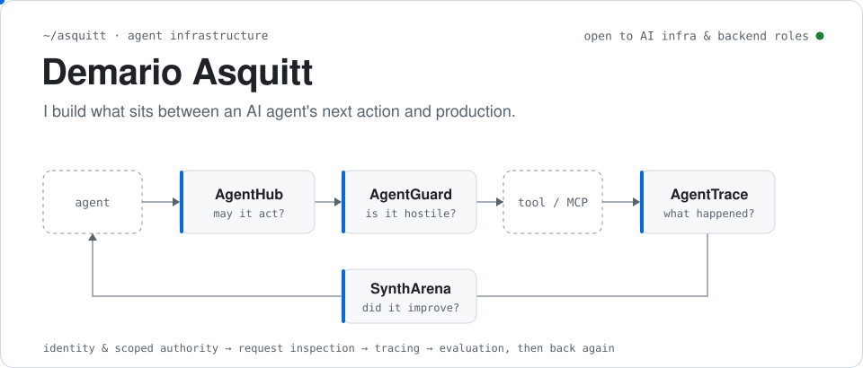
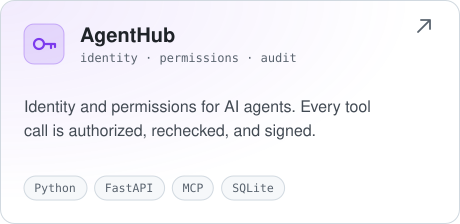
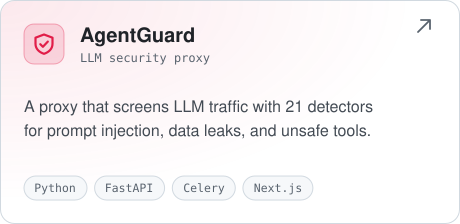
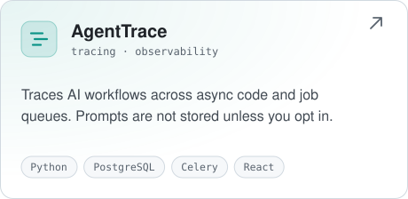
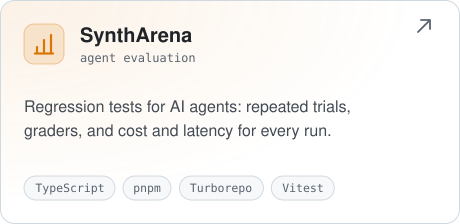
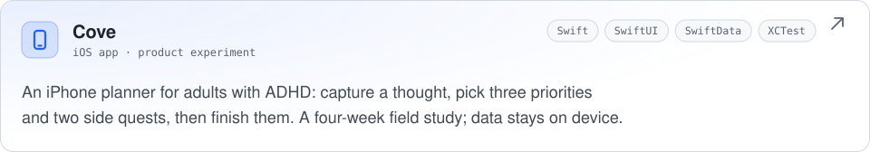

<picture>
  <source media="(prefers-color-scheme: dark)" srcset="assets/banner-dark.svg">
  
</picture>

  
  
  

Most agent demos stop once the model calls a tool. I work on what comes after: checking whether the agent was allowed to act, whether the input was safe, what actually happened, and whether the last change made things better. Each of those questions is its own project below.

## Selected work

  <a href="https://github.com/asquitt/agent-hub"><picture><source media="(prefers-color-scheme: dark)" srcset="assets/card-agent-hub-dark.svg"></picture></a>
  <a href="https://github.com/asquitt/agent-guard"><picture><source media="(prefers-color-scheme: dark)" srcset="assets/card-agent-guard-dark.svg"></picture></a>

  <a href="https://github.com/asquitt/agent-trace"><picture><source media="(prefers-color-scheme: dark)" srcset="assets/card-agent-trace-dark.svg"></picture></a>
  <a href="https://github.com/asquitt/synth-arena"><picture><source media="(prefers-color-scheme: dark)" srcset="assets/card-synth-arena-dark.svg"></picture></a>

  <a href="https://github.com/asquitt/cove"><picture><source media="(prefers-color-scheme: dark)" srcset="assets/card-cove-dark.svg"></picture></a>

## How I work

- **Set the limits first.** Every tool call has a defined scope, every trace has an owner, and every retry knows what already happened.
- **Make claims you can check.** Tests cover the failure paths, examples run, and each README says plainly what the code doesn't do.
- **Remember the user.** Reliability matters because someone is trying to get work done.

## Background

- Built a conversational AI platform that gives universities self-serve access to course, tuition, and admissions data. It handles **100K+ chats a month**. Stack: FastAPI, Java, Scala, Postgres, Elasticsearch, Kafka, and a Next.js front end that meets WCAG 2.1.
- 🥇 **1st Place, NEDSI Annual Conference 2022** for using multilingual sentiment analysis to predict threats from social media.

## Toolbox

---

Open to backend and AI infrastructure roles. <a href="mailto:demarioasquitt@gmail.com">Get in touch</a>. Older projects (2020–2023) live at <a href="https://github.com/demarioasquitt">@demarioasquitt</a>, an account I no longer have access to.
